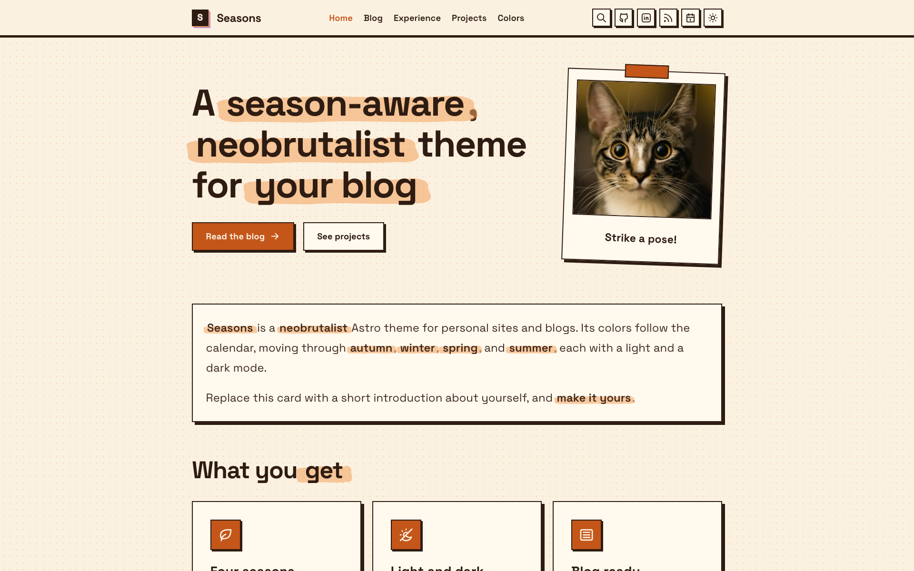
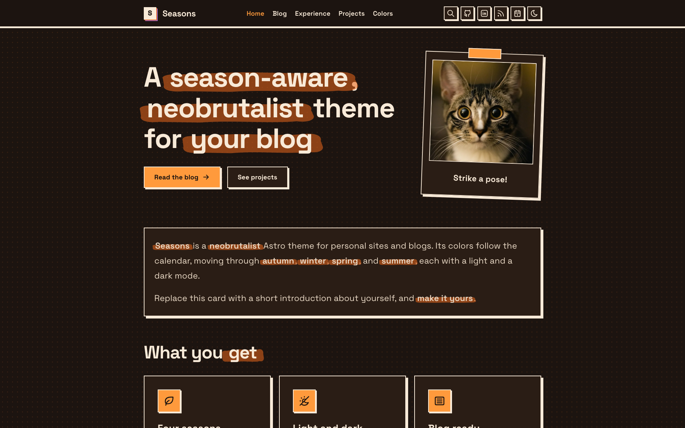
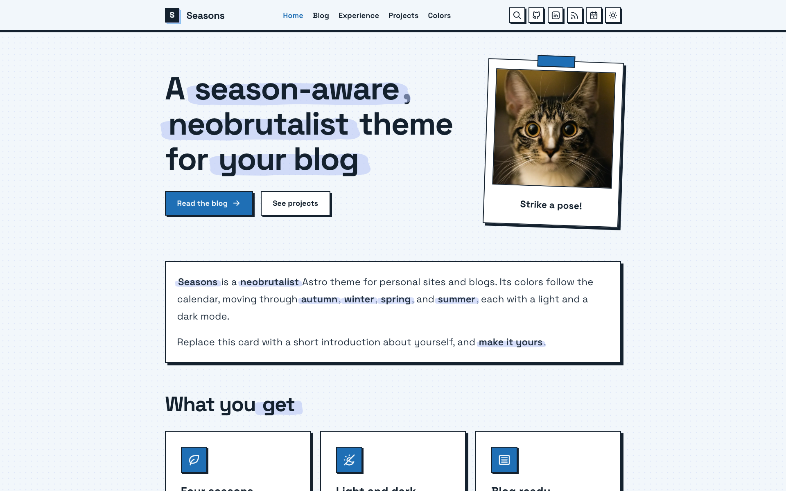
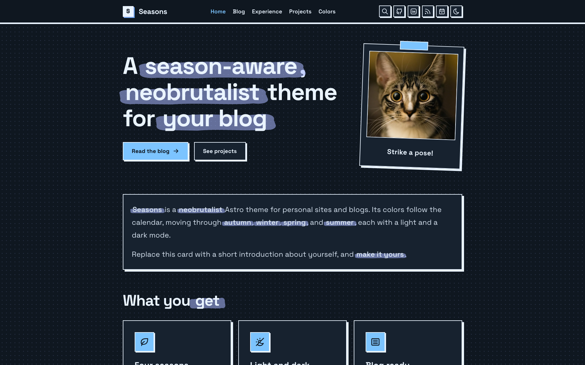
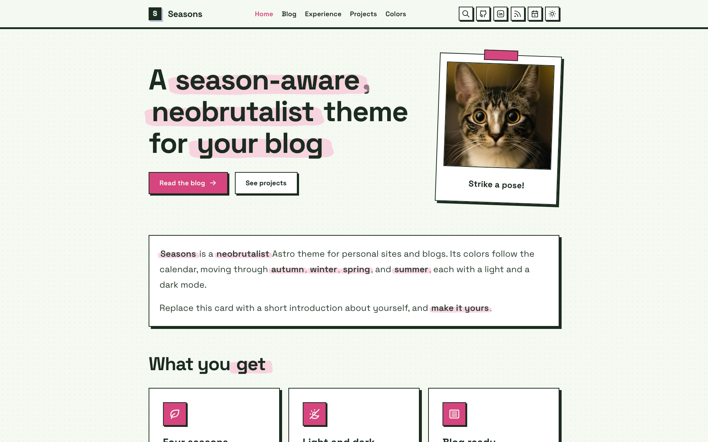
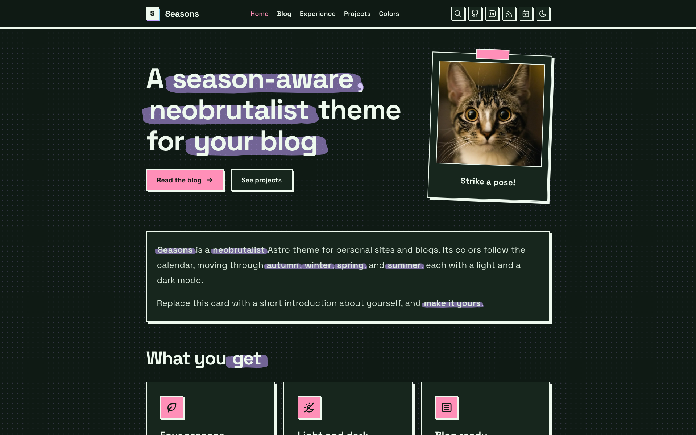
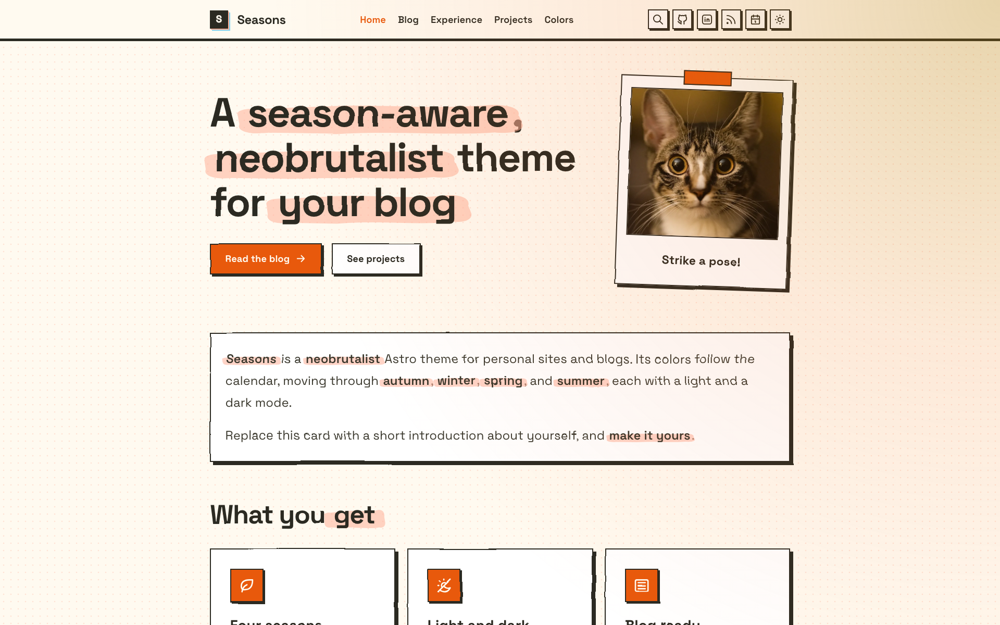
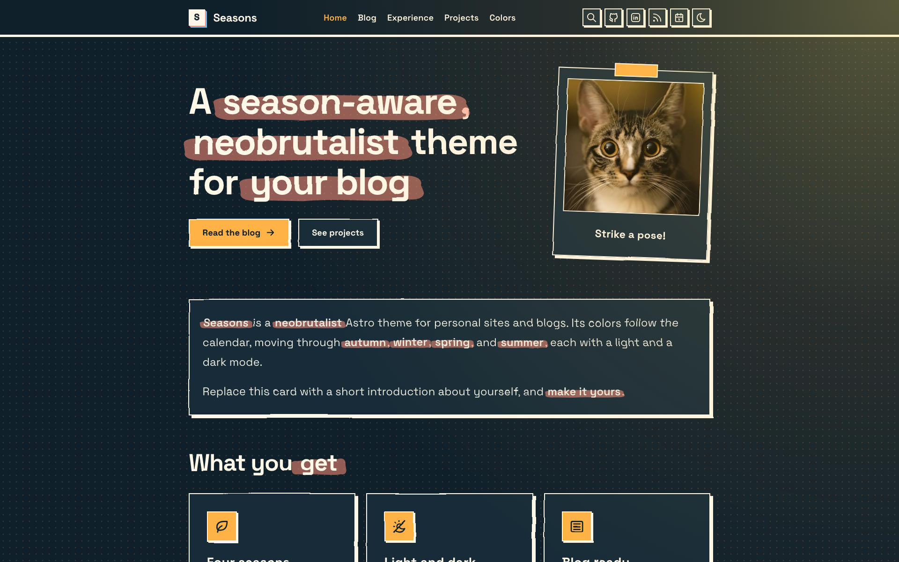

# Asheel Mohammad — Portfolio

Personal portfolio for **Asheel Mohammad** (B.Tech Computer Science specializing in Cyber Security), built with [React](https://react.dev/), [Vite](https://vite.dev/), and Tailwind CSS. Showcases cybersecurity, penetration testing, Python/SQL, and frontend projects with category/tech filtering, keyboard command search (`Ctrl+K`), an interactive contact page, and seasonal light/dark themes.

## Customizing your portfolio

- **Profile, skills, projects & experience**: edit [`src/lib/portfolio.ts`](src/lib/portfolio.ts)
- **Site name, contact email & social URLs**: edit [`src/lib/site.ts`](src/lib/site.ts)
- **Hero portrait photo**: replace [`src/assets/home/portrait.jpg`](src/assets/home/portrait.jpg)

## Getting started

Install the dependencies and run the project:

```sh
npm install
npm run dev           # dev server on :5173
npm run build         # production build
npm run preview       # preview the production build
npm run check         # TypeScript type checking
npm run lint:check    # lint with ESLint
npm run lint:fix      # lint and apply safe fixes
npm run format:check  # check formatting with Prettier
npm run format:fix    # format files with Prettier
npm run test:e2e      # Playwright E2E and screenshot tests
```

> [!NOTE]
> `npm install` also sets up a Husky pre-commit hook that runs `lint:check`, `format:check`, and `check`. Fix failures before committing.

## Seasonal theme

The site switches palettes by date. Every family has a light and a dark variant, defined in `src/styles/palettes.css`:

- `neon-*`: not tied to a date, only available from the theme picker
- `autumn-*`: used from Sept 22 to Dec 21
- `winter-*`: used from Dec 22 to Mar 19
- `spring-*`: used from Mar 20 to Jun 20
- `summer-*`: used from Jun 21 to Sept 21

|        | Light                                              | Dark                                             |
| ------ | -------------------------------------------------- | ------------------------------------------------ |
| Autumn |  |  |
| Winter |  |  |
| Spring |  |  |
| Summer |  |  |

How it works:

- The family is picked from the visitor's local date on every page load, so no rebuild is needed when a season starts or ends.
- The mode (light or dark) comes from the theme toggle, falling back to `prefers-color-scheme`. Only the mode is stored (`site-mode` in `localStorage`), so a saved preference carries across seasons.
- The legacy `site-palette` value is migrated to `site-mode` and removed.
- `initializePalette()` in `src/lib/palette.ts` sets `data-palette` on `<html>`. `index.html` runs an inline pre-paint script and `src/main.tsx` calls `initializePalette()`, while `body` stays hidden until the attribute is set (visible when scripting is off) to avoid a flash of the wrong colors.
- The theme toggle switches between light and dark within the active family.
- The theme picker in the navbar (before the light/dark toggle) overrides the date: Automatic (follow the date, the default), Autumn, Winter, Spring, Summer (under a "Seasons" divider), or Neon (under an "Other" divider). The choice is stored in `localStorage` as `site-theme` (removed for Automatic), and the matching falling effect follows it.

Autumn, winter and spring each have a falling effect on the home page (`FallingLeaves`, `FallingSnow`, `FallingPetals`). Summer has two ambient effects instead: `HeatShimmer` (an SVG displacement filter that makes the page content shimmer) and `Sunlight` (a pulsing warm glow in the top-right corner). Every effect is shown only under its palettes and when `prefers-reduced-motion` allows it.

To change the dates, edit `seasons` in `PALETTE_CONFIG` (`MMDD` numbers, inclusive; a range with `start` after `end` wraps the new year). To add a season, add it to `THEME_CHOICES` and the picker options in `src/components/header/ThemePicker.tsx`, then add `[data-palette='<name>-light']` and `<name>-dark` blocks to `palettes.css`, add its name to `PaletteFamily`, and add its range to `seasons`.

To preview a season, set it in the browser console, e.g. `document.documentElement.dataset.palette = 'autumn-dark'`.

## Testing

Tests use [Playwright](https://playwright.dev) and live in `src/tests/`:

- `src/tests/e2e/`: behavior checks, e.g. the home page title and which falling particles show in each season
- `src/tests/screenshots/`: captures the home, blog, blog post, experience, projects, tags and 404 pages in light and dark, one spec per page
- `src/tests/fixtures/blog/`: fixture posts the Playwright build uses in place of the real ones

Set up once per machine:

```sh
npx playwright install chromium
```

Then run the tests. Playwright builds the site and serves it with `vite preview` on port 4322, so it never collides with the dev server on :5173:

```sh
npm run test:e2e                                        # everything
npx playwright test src/tests/e2e                       # E2E only
npx playwright test src/tests/screenshots               # screenshots only
npx playwright test --ui                                # interactive runner
npx playwright show-report                              # open the last HTML report
```

### Screenshots

- Each of those pages is captured at 1920x1200 in light and dark. The home page is captured once for each season, and the other pages in summer only.
- The clock is pinned (July 15 for summer, Oct 15 for autumn, Jan 15 for winter, Apr 15 for spring), so results don't depend on today's date.
- `falling-particles` captures the home page with the falling effects frozen mid-fall (autumn, winter and spring; summer has no particles), since the other screenshots disable animations and so hide the particles. Names look like `falling-particles-autumn-dark.png`.
- The color scheme is emulated with `prefers-color-scheme`.
- Content is pinned too. The Playwright build sets `USE_FIXTURE_POSTS`, which makes the content collection in `src/content.config.ts` load the posts in `src/tests/fixtures/blog/` instead of `src/content/blog/`. Adding or editing a real post leaves `screenshots/` unchanged, and `blog-post` points at `/blog/fixture-post-one/`.
- Fixture posts have fixed titles, tags, and dates. Edit them only when a screenshot should change, and keep a word like "tool" in one of them, since the search E2E spec queries it.
- Screenshots are written to `screenshots/` (overwriting the previous ones) and are not part of the deployed site. Names look like `home-autumn-dark.png` and `blog-post-summer-dark.png`.
- They are captured, not compared, so the tests don't fail on visual changes. Review the images in `git diff` before committing.
- To capture another page, create `src/tests/screenshots/<page>.spec.ts` that calls `defineScreenshotTests('<page>', '/<path>/')` from `./support`. Pass `[SUMMER_SEASON, AUTUMN_SEASON, WINTER_SEASON, SPRING_SEASON]` as a third argument to cover every palette.

The `Checks` workflow runs lint, format, and E2E as parallel jobs after a shared dependency setup, on pushes and pull requests to `main`. It can also be started manually.

## Deploying under a sub-path

Served from the root of a domain (a `<user>.github.io` repository or a custom domain), the site needs no extra setup. Served from a sub-path (a GitHub Pages project page at `https://<user>.github.io/<repo>/`), set two environment variables at build time:

```sh
SITE_URL=https://<user>.github.io BASE_PATH=/<repo> npm run build
```

`vite.config.ts` passes them to Vite's `base` option and `import.meta.env.VITE_SITE_URL`. With neither set, the build is for a domain root. `.github/workflows/deploy.yml` sets both from the repository owner and name and deploys to GitHub Pages. To use it for your own copy, remove the `if: github.repository == ...` line, then set **Settings > Pages > Source** to **GitHub Actions**.

Vite's `base` rewrites assets it generates. Root-absolute paths you write by hand are not rewritten, so wrap them with `withBase()` from `src/lib/paths.ts` (or use React Router `<Link>` for internal navigation):

```tsx
import { withBase } from '@/lib/paths';

<a href={withBase('/rss.xml')}>RSS</a>;
```

This applies to `href`, `src`, and `fetch` URLs in `.tsx` and `.ts` files. In Markdown, use relative links (for example `../markdown-features/`) so they work under any base. `withBase()` returns the path unchanged when there is no base.

## Customizing

Site-wide values (site name, author name, description, job title, site URL, the GitHub and LinkedIn profile links, and the blog, tags, experience, and projects page descriptions) live in `src/lib/site.ts`. The header, footer, page titles, RSS feed, search, and structured data all read from it, and the letter in the header logo is the first character of `SITE_NAME`. Everything else to customize:

- `src/components/header/Header.tsx` and `src/components/layout/Footer.tsx`: navigation, header icons, footer
- `src/pages/HomePage.tsx`: the home page heading and the intro card
- `src/components/experience/` and `src/pages/ExperiencePage.tsx`: the experience page. Each job is one component built on `ExperienceEntry.tsx`. Rename, edit, or add components, then list them in `src/components/experience/ExperienceSection.tsx`
- `src/components/projects/` and `src/lib/projects.ts`: the projects page. Edit the `PROJECTS` array in `ProjectsSection.tsx` (name, description, technologies, and a `links` array of `{ kind, url }`, with an optional `isCooking` flag), add link kinds in `src/lib/projects.ts`, and update the matching body in `src/lib/search.ts`
- `src/lib/search.ts`: the search entries for the static pages (home, blog, tags, experience, projects). Their descriptions come from `site.ts`, but the home, experience, and projects bodies are plain text, so update them when you change those pages
- `public/favicon.svg`: the tab icon, a static file that doesn't follow `SITE_NAME`, so replace it with your own
- `src/lib/palette.ts`: the seasonal palette logic and its config (storage keys, season dates); see [Seasonal theme](#seasonal-theme)
- `src/lib/colors.ts`: the color tokens listed on the `/colors/` page; add a token here when you add one to `src/styles/palettes.css`
- `public/robots.txt`: the sitemap URL (a static file, so it can't import from `site.ts`). Crawlers only read `robots.txt` at the root of a domain, so it has no effect on a sub-path deploy
- `public/assets/og.png`: social preview image, 1200x630. It's a screenshot of the autumn home page, so replace it with your own

## Writing posts

Posts are markdown files in `src/content/blog/` with `title`, `description`, `date`, optional `tags`, and optional `draft` frontmatter. Each tag links to its archive page under `/tags/`. `markdown-features.md` shows the frontmatter and every supported markdown feature, and `make-it-yours.md` is a short customization guide. Delete both when you add your own posts.

## Project structure

```
src/
  components/     # reusable UI, grouped by feature
  content/blog/   # posts as markdown / MDX
  lib/            # post and tag helpers, palette config, particle shapes, color token list, site constants
  pages/          # HomePage, BlogPage, BlogPostPage, ExperiencePage, ProjectsPage, ColorsPage, TagsPage, TagPage, NotFoundPage
  styles/         # global styles, design tokens, palette definitions, component styles (Tailwind CSS)
  tests/          # Playwright specs: e2e/ and screenshots/
screenshots/      # committed screenshot baselines (not deployed)
public/
  assets/         # font, og image
```

## License


